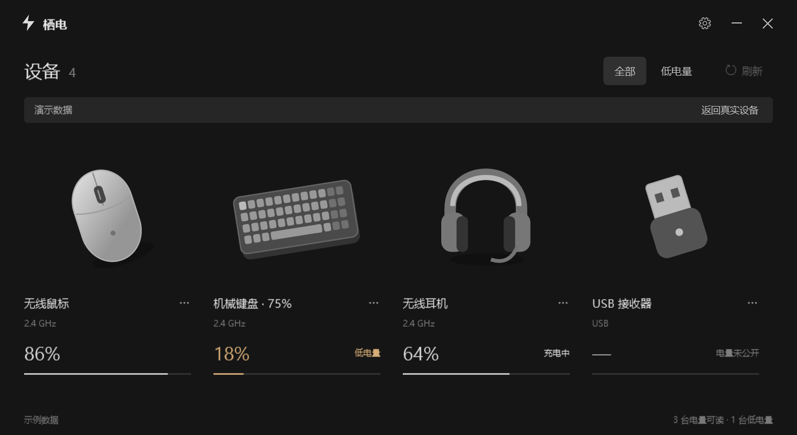

# 栖电 · Peripheral Power

一个 Windows 托盘工具，查看 USB 设备连接状态和受支持的外设电量。黑灰主题、横向无边框设备展示。原生 C# / WPF，无 Electron、网页服务或联网账号。

**当前版本：0.2.0。修复插拔后连接列表更新不及时的问题。电量读取仍取决于设备协议。** 变更详见 `CHANGELOG.md`。



## 下载

在本仓库的 [Releases](https://github.com/irusxc/device_battery/releases) 页面下载 `PeripheralPower-0.2.0-win-x64.zip`，解压后运行。GitHub 自动生成的 **Source code (zip)** 是源码包，不包含可直接运行的程序。若尚未创建 Release，请按下方“开发与验证”自行构建。

维护者发布步骤见 [GitHub 发布说明](docs/PUBLISHING.md)。

## 直接使用

1. 解压从 Releases 下载的 ZIP；本地构建包位于 `dist/v0.2.0/PeripheralPower-0.2.0-win-x64.zip`。已运行旧版时，先右键旧版托盘图标选择“退出栖电”，再启动新版。
2. 双击 `PeripheralPower.exe`。需要 Windows 10 / 11 x64 和 .NET Framework 4.8；多数现代 Windows 已自带。
3. 插拔设备时，Windows 通知触发连接清单检测；250 ms 合并连续通知，并独立每 3 秒补查一次清单。电量默认每 60 秒查询。右上角“刷新”或 F5 可立即刷新两者。
4. 点击系统托盘中的闪电图标打开 / 收起面板。关闭窗口或按 Esc 后仍在托盘运行；右键托盘选择“退出栖电”可完全退出。设备较多时可使用滚轮、横向滚动条和左右键浏览。

若此前启用了登录启动，请在新版设置中勾选“登录 Windows 后在托盘启动”，使启动路径更新为新版。设备分组标识已修正，旧版自定义图片可能需重新选择。

分享给朋友时直接发送 ZIP，让对方解压后运行；不需要 Python、开发工具或管理员权限。此版本未进行代码签名。

## 已具备的功能

- 自动发现 Windows PnP 清单中的物理 USB 设备，按照 USB 父节点合并复合接口；排除 USB 集线器。
- 鼠标、键盘、耳机、接收器的原创矢量示意图；可在设备卡片的“···”菜单中更换本地型号图片。
- 电量百分比、电量档位、协议提供的充电状态、低电量筛选，以及最后扫描时间。
- 默认 20% 低电量托盘提醒；同一设备最多每 4 小时重复提醒，充电时不提醒。Windows 通知设置可能影响提示展示。
- 30 / 60 / 120 秒刷新间隔，可选登录启动；登录启动默认关闭。
- 真实扫描与明确标识的界面演示。演示时后台仍更新真实连接信息，暂停低电量提醒；退出演示显示最新真实结果。
- 导出本地诊断 JSON，供后续适配使用。没有自动上传、遥测或在线图片下载。
- 单实例运行。重复启动会打开现有窗口。
- 电量读取在独立进程，单次总时限 25 秒；设备连接清单独立更新，慢电量响应不再阻塞插拔显示。插拔变化会使旧查询结果失效并重新读取。

## 当前的支持边界

| 设备 / 协议 | 当前行为 |
| --- | --- |
| 通过标准 HID Battery Strength 提供电量的设备 | 读取逻辑范围为 0–100 的 Feature / Input 报告，显示设备返回的百分比 |
| 暴露标准长报告接口的 Logitech HID++ 2.0 设备 | 实现 0x1004 Unified Battery 和 0x1000 Battery Status 查询；可逐个探测接收器的 1–6 号槽位 |
| 返回电量档位但没有百分比的设备 | 显示“充足 / 良好 / 偏低 / 极低”，不将档位转换为虚构百分比 |
| 其他品牌私有协议 | 设备连接信息仍显示，电量显示“电量未公开”，需要后续添加适配器 |
| 设备休眠、被驱动独占或查询超时 | 显示未响应 / 扫描提示，或明确标记上次数据；不当作新鲜电量 |
| 有线鼠标、键盘、USB 打印机等 | 显示连接状态；没有电池信息时不生成百分比 |
| 只暴露 USB 音频接口、不暴露 USB HID 接口的耳机 | 可通过 USB PnP 清单发现物理 USB 设备；电量仍需厂商适配 |
| 蓝牙、HID++ 1.0、罗技仅提供电压的协议、Centurion 设备 | 当前不支持对应电量读取 |

**识别接收器不等于识别其后面的真实型号，也不等于能够读取电量。** 2.4 GHz 只是无线连接方式，Windows 没有覆盖所有厂商的统一电量接口；同一接收器型号也可能连接不同设备。本项目不会仅凭接收器 VID/PID 猜测设备型号、图片或电量。

HID++ 实现已通过构造报文解析测试，但开发环境没有可用罗技无线设备进行实机验证；标准 HID 电量也需要对应硬件验证。0.2.0 在本机识别到 `USB Optical Mouse`（PixArt，`VID_093A&PID_2510`）和旧版遗漏的 `HP LaserJet Pro MFP M126nw`（`VID_03F0&PID_222A`）。它们均未返回电量，显示为未知。

连接状态优先由 Windows 插拔通知驱动，通知缺失时在下一次 3 秒清单检查中发现变化；实际时延还受 Windows 驱动枚举时间影响。电量查询与连接检测独立，更新速度与精度取决于外设固件，不保证即时电量推送。无法判断无线方式时只显示 USB。

## 型号图片

最方便的方式：点击设备卡片“···” → “更换型号图片”，选择 PNG、JPEG 或 BMP。程序会复制一份到本地配置目录。建议使用透明背景正视图，文件不超过 10 MB。

需要让朋友共享型号库时，可编辑 EXE 同目录的 `device-catalog.json`：

```json
[
  {
    "HardwareId": "VID_XXXX&PID_XXXX",
    "ReportedName": "设备实际上报的完整型号名称",
    "DisplayName": "希望在卡片中显示的名称",
    "Kind": "mouse",
    "Image": "images/my-mouse.png"
  }
]
```

`ReportedName` 必须匹配真实设备名称；`HardwareId` 可省略。`Kind` 支持 `mouse`、`keyboard`、`headset`、`receiver`、`printer`、`scanner`、`camera`。将有权分享的图片放入 `images`，随整个文件夹一起分享。修改型号库后重新启动。未匹配时使用通用示意图，鼠标悬停可查看“通用设备示意图”提示。

## 数据与隐私

- 设置和自选图片：`%LOCALAPPDATA%\PeripheralPower`。
- 登录启动只在用户勾选后写入当前用户的 Windows Run 注册表项。
- 原始 HID 路径和 PnP 实例标识仅用于本地发现 / 查询；导出时仅包含散列后的设备标识。
- 诊断包含设备名称、制造商、VID/PID、散列后的内部标识、接口描述、电量结果和时间；不主动读取序列号字段，不包含原始设备路径。设备名称由厂商提供。
- 不注册后台服务，不安装驱动。退出后停止监测。
- 卸载前取消“登录 Windows 后在托盘启动”，退出程序并删除解压文件夹；需要彻底清理时，可删除上述本地配置目录。

## 开发与验证

源码位于 `src`。构建只需 Python 3 和 Windows 自带的 .NET Framework 4.x C# 编译器，无需下载 NuGet 包：

```text
python tools/build.py
python tools/verify.py
python tools/check_runtime.py
```

构建结果在 `dist/v0.2.0`；验证报告、真实扫描 JSON 和截图位于 `build`。验证包括 31 项协议 / 逻辑检查、21 项连接监测检查、22 项界面检查，以及实际 PnP / HID 枚举与正常、窄窗口、设置页渲染。监测回归覆盖慢电量查询期间插拔、迟到结果、连续变化合并和通知遗漏。实际注册了隐藏窗口设备通知，但未远程验证朋友电脑的物理插拔时延。`check_runtime.py` 用隔离的测试实例验证后台启动、单实例激活和关闭到托盘，不关闭已有的用户实例。

主程序约 108 KiB。本机运行测试工作集约 100 MiB，具体数值随系统、字体缓存和设备数量变化。界面采用软件渲染；未做长期运行、游戏帧率或多厂商无线设备性能验证。

| 文件 | 作用 |
| --- | --- |
| `src/Hid.cs` | Windows HID 枚举、标准电量适配及 `IBatteryAdapter` 接口 |
| `src/UsbInventory.cs` | 无需打开设备的 USB PnP 连接清单和物理设备分组 |
| `src/DeviceMonitor.cs` / `src/DeviceNotifications.cs` | 连接与电量独立调度、变化通知、旧结果失效和补扫 |
| `src/Logitech.cs` | HID++ 查询、应答匹配、设备扫描调度 |
| `src/Models.cs` | 数据、图片目录、提醒策略和配置 |
| `src/MainWindow.xaml` / `src/DesktopApp.cs` | 界面、托盘、后台读取和交互 |
| `src/DeviceArt.cs` | 原创设备示意图 |
| `src/SelfTests.cs` / `src/UiTests.cs` / `src/MonitorTests.cs` | 协议、交互和异步插拔回归检查 |
| `PROTOCOLS.md` | 新品牌适配方法和协议参考 |

若后续新增厂商，请先收集诊断文件、明确型号和已确认的电量读取协议，再实现新的适配器。当前适配器通过源码扩展并重新编译；不是随意下发 HID 指令的配置工具。

MIT 许可证，允许修改和分享。设备品牌和型号名称归各自权利人所有。
